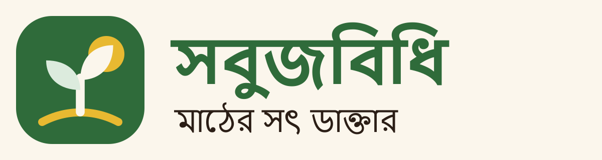

# সবুজবিধি (Sobujbidhi)



The name means "green rule" (সবুজ, green; বিধি, rule or prescription). The app was called Crop Guardian until November 2026; browser storage keys, cache names and IndexedDB still use `crop-guardian`, so phones keep their fields, sprays and saved cases. The logo is `src/app/icon.svg` (also the favicon, and `LogoMark` on Home); `src/app/apple-icon.png` and `public/logo.png` are rendered from it.

**মাঠের সৎ ডাক্তার** — a Bengali, mobile-first UI for advising potato farmers on late blight, and paddy farmers on rice blast: daily risk from the weather, leaf photo diagnosis that admits uncertainty (potato, and paddy as an experiment, see [Paddy diagnosis](#paddy-diagnosis)), an area risk map, and a season ledger. Every number on screen comes from a real source: the weather forecast, the farmer's own records on the phone, or cases an agriculture officer has confirmed. There is no sample or demo data.

Built with Next.js (App Router), TypeScript and Tailwind CSS v4.

## Why potato late blight

This is a deliberate focus: one crop and one disease done honestly, rather than many done thinly.

- **Potato is a main winter crop of northern Bangladesh**, and late blight (নাবি ধসা) is its most destructive disease. A 16-district survey found it cuts yields by up to 30% ([Potato Research, 2022](https://doi.org/10.1007/s11540-022-09581-w)).
- **It is driven by the weather**, so it can be forecast. Fog and cold, wet spells in December–January spread it within days. A warning the afternoon before lets a farmer spray in time. Whether a quiet forecast can also save calendar sprays is not shown: the rule calls danger in most winter weeks and isn't validated against outbreaks ([docs/rule-comparison.md](docs/rule-comparison.md)), so the app never says a spray isn't needed.
- **It has look-alikes** (early blight, other leaf spots), which is where a photo check that admits doubt helps most.

**Pests are not covered.** The challenge asks for pests and diseases. We chose to cover one disease end to end (forecast, SMS alert, photo check, officer review, ledger) first. The pieces are built to grow:

- **More crops and diseases.** Crops are a registry (`src/lib/crops.ts`), and paddy blast already runs on it as a draft rule (experimental).
- **More photo classes and crops.** Each crop's photo model, classes and thresholds come from its own exported config (`src/lib/diagnosis/crops.ts`). Paddy diagnosis runs end to end on a model trained by [`notebooks/paddy_training.ipynb`](notebooks/paddy_training.ipynb), labelled experimental; pests such as potato tuber moth or aphids would be new classes the same way.
- **More places.** The area list already covers the 17 potato districts of Rangpur and Rajshahi divisions and Munshiganj, down to unions.

See [Limitations and next steps](#limitations-and-next-steps) for what is not yet validated.

## Run

```bash
npm install
npm run dev      # http://localhost:3000
npm run build && npm start
npm test         # unit tests (node:test)
npm run test:e2e # smoke test in your installed Chrome at 360×640: builds, then starts in showcase mode
npm run typecheck
npm run lint
```

On a locked-down network `npm install` can fail because `onnxruntime-node` (used only by the parity test) downloads its GPU files from NuGet. Set `ONNXRUNTIME_NODE_INSTALL_CUDA=skip` first.

## Screens

| Route | Screen |
|---|---|
| `/` | Home: today's live risk at the farmer's union for each field in season (a chip per field), 5-day forecast, today's decision; a 4-card intro on first open |
| `/camera` | Leaf photos (top, then underside) and on-device diagnosis |
| `/result/uncertain` | "Not sure": the candidates the photos left |
| `/questions` | Short questions that narrow the candidates: up to two for potato, up to five for paddy |
| `/result` | Final diagnosis, including "healthy" |
| `/unknown` | Can't identify: send to agriculture officer |
| `/map` | The unions of the farmer's upazila (Shibganj, Bogura, until one is chosen): today's weather risk per crop (আলু · ধসা / ধান · ব্লাস্ট) and officer-confirmed cases |
| `/ledger` | A field's season (`?field=potato\|boro\|aman`) from the real weather and the sprays the farmer logged |
| `/planting` | "আমার জমি": the farmer's place (district → upazila → union, `?d=`/`?u=` are the steps), and their fields: crop (আলু, or ধান with বোরো/আমন) and planting date, one tap from আজ, ১/২/৩ সপ্তাহ আগে or ১ মাস আগে, or «অন্য তারিখ» for day/month/year (`?season=` opens one) |
| `/guide` | How to use the app, in plain Bengali, each part read aloud |
| `/potato` | Potato growing advice for Bangladesh: planting, varieties, late blight, wilt, harvest, storage, stored-tuber diseases, with sources |
| `/ask` | «কৃষি সহায়ক»: questions answered in Bengali from the app's own advice, with sources |
| `/docs` | How it works, in English, for judges, partners and agronomists: the evidence and how AI is used |
| `/sign-in` | Mobile number, then the SMS code (`?next=` is where to go after) |
| `/account` | The signed-in number and role, SMS risk alerts on/off, sign out (from the person button on Home) |
| `/officer` | Agriculture officers only: where farmers' cases will be listed |

Home, the map, the ledger, the guide, `/planting`, `/potato` and `/account` share a bottom nav that stays on screen: হোম · ম্যাপ · ছবি · হিসাব · প্রশ্ন. ছবি (`/camera`) is a big round button raised above the bar. The camera and `/ask` have their own layouts without it.

## Late-blight risk

Home's risk is computed from the weather, with no ML. `src/lib/weather.ts` fetches a 5-day hourly forecast (temperature, relative humidity) at the centroid of the farmer's union (or Shibganj upazila, Bogura, before one is chosen) from [Open-Meteo](https://open-meteo.com/) (no API key, cached for 1 hour, 5 s timeout). `src/lib/risk.ts` applies the Hutton criteria to it:

- A day **qualifies** when its min temperature is ≥ 10°C and RH ≥ 90% for ≥ 6 hours.
- **বিপদ (danger)**: the day and the day before or after it both qualify (a Hutton period).
- **সতর্ক (watch)**: the day qualifies alone, or is ≥ 10°C with 4–5 humid hours.
- **নিরাপদ (safe)**: otherwise.
- Today's overall risk is today's level, raised to watch if a danger day falls within the next 2 days.

The same result is served as JSON at `GET /api/risk` (optional `lat`, `lon`, by default the farmer's union; optional `crop=potato|paddy`, potato by default). If the forecast can't be fetched, Home says so ("আবহাওয়ার তথ্য আনা যায়নি") and shows no risk at all, never an old or made-up one.

The header line under the risk and the text under today's decision are generated from the forecast numbers. When a danger day is ahead it is named from the forecast, never as a fixed weekday, with the afternoon before it. A farmer with [SMS alerts](#sms-alerts) on is promised a text then ("বুধবার থেকে ঝুঁকি বাড়বে। কাল বিকেলে SMS-এ জানাব।"); anyone else is asked to look again ("… কাল বিকেলে আবার দেখে নিন।"). The app never promises a message it won't send. On a danger day the decision's title is "আজই পাতা দেখুন", and the text makes the spray conditional on what the farmer finds ("পাতায় দাগ পেলে ২ দিনের মধ্যে স্প্রে করুন"; for paddy, "পাতা আর শীষে দাগ পেলে দ্রুত স্প্রে করুন"), because the rule isn't field-validated. The card has a "পাতার ছবি তুলুন" button for that crop above "আজ স্প্রে করেছি", and on those days the big camera button under the card is hidden (`HomeCameraButton`, which follows the same field `FieldsGate` shows), so only the card's and the nav's remain. Both lines are kept to two lines on a phone; the tests guard their length.

Potato risk is labelled পরীক্ষামূলক (`experimental: true` in `crops.ts`) under the decision, on the map legend, on the ledger and in the SMS, as paddy's is. No text tells a farmer that spraying isn't needed or that money is saved by not spraying: a quiet day says the weather is drier and to keep checking the leaves («কয়েক দিন আবহাওয়া তুলনায় শুকনো। তবু নিয়মিত পাতা দেখতে থাকুন।»). `saysNoNeed` in `src/lib/assistant/guard.ts` recognises such text; the tests run it over every screen text, card, result, SMS and knowledge-base chunk, and the assistant drops any sentence it matches (as it drops a dose) and says to keep checking instead.

### Past weather

To check the rule against past winters, list every danger day in the last three Dec–Feb winters:

```bash
npx tsx scripts/find-hutton-periods.ts            # add --write to update docs/risk-backtest.md
```

[docs/risk-backtest.md](docs/risk-backtest.md) compares how often the app's rule and a stricter one (≥ 10 humid hours) would have alerted in those winters, using two independent sources of past weather: the Open-Meteo archive and [NASA POWER](https://power.larc.nasa.gov/) (MERRA-2, `fetchHourlyNasaPower` in `src/lib/weather.ts`). The two sources agree on only a third to a half of the danger days. NASA POWER is coarser (about 50 km) and its humidity rarely stays at 90% for long, so it finds fewer danger days, and almost none under the stricter rule. That spread is a finding in itself: the rule depends on the humidity of whichever weather model feeds it. It needs checking against a field station and real outbreak dates (see [Limitations](#limitations-and-next-steps)).

```bash
npx tsx scripts/compare-blight-rules.ts           # add --write to update docs/rule-comparison.md
```

[docs/rule-comparison.md](docs/rule-comparison.md) puts three rules side by side at Shibganj for 2019–20 and the last three winters, on both sources: the app's, the stricter one, and JHULSACAST (`src/lib/jhulsacast.ts`, CPRI's forecast for the West Bengal plains: 7-day and 5-day moving sums of humid and mild hours, the 5-day one with rain, which is why `fetchHourlyArchive` and `fetchHourlyNasaPower` also fetch hourly precipitation). For each it gives danger days, danger weeks out of the 12 full weeks from 1 Dec, the first day it fires, and the calendar sprays the ledger would count as saved. It also checks one dated outbreak report (Lalmonirhat, Feb 2020); that is one event, not a validation. The app's rule is unchanged; the comparison is there to choose it.

The same report measures the models' humidity against three Bangladesh Meteorological Department synoptic stations (Bogura 41883, Rangpur 41859, Dinajpur 41863), from NOAA's Integrated Surface Database (`src/lib/isd.ts`: 3-hourly SYNOP readings, each standing for 3 hours, RH from dew point). It compares four sources at each station: the station itself, the Open-Meteo archive, NASA POWER and the Open-Meteo Historical Forecast API (`fetchHourlyHistoricalForecast`, the live app's model replayed, from 2022). It shows humid hours by month, the most humid week, the three rules on station data, and the RH threshold on each model that matches the station's hours at 90% (`src/lib/humidityGap.ts`). That threshold is reported, not applied.

Last, the report sets a calendar of dated late-blight reports (`src/lib/outbreaks.ts`, 2016–17 to 2024–25: news reports and BAMIS warnings, each recorded as its text reads, with the earliest date of disease it implies) beside the 7-day sum of humid hours at the 11 BMD stations within 30 km of the app's unions (`scripts/outbreak-humidity.ts`). It shows which reports have station data, each winter's sums and first crossings of 60, 75, 90 and 105 hours, and a calendar baseline (whether the crossing date moves with the outbreak date). It chooses no threshold. NOAA's copy misses 7 Jan – 19 Feb 2020 at every station; for Rangpur that gap is filled from OGIMET's SYNOP archive (`src/lib/ogimet.ts`, `scripts/stationData.ts`), whose decoded readings equal ISD's wherever both exist. Every download is kept in the gitignored `.cache/` (`scripts/fetchCache.ts`), so a stopped run resumes and a rerun fetches nothing; delete `.cache/` to fetch afresh.

## Rice-blast risk (paddy, experimental)

Paddy fields get rice-blast risk from the same forecast (`src/lib/blast.ts`), with no ML and no extra request. It is a draft BLASTAM-style rule, to be confirmed with BRRI before farmers rely on it, so Home labels it "পরীক্ষামূলক". Open-Meteo has no leaf wetness, so an hour at RH ≥ 90% stands in for a wet leaf:

- A **wet hour** has RH ≥ 90% at 18–28°C. A day **qualifies** with ≥ 10 wet hours.
- **বিপদ**, **সতর্ক** (a lone qualifying day, or 7–9 wet hours) and **নিরাপদ**, and the 2-day lookahead, work as for late blight; both rules share `classifyRun`, `overallRisk` and `buildDecision` in `risk.ts`.
- The header line names the wet hours from the forecast, or says the humid hours are too cold or too hot for blast. The decision text asks the farmer to look for eye-shaped spots on the leaves, and at the panicle neck on danger days.

`src/lib/crops.ts` is the one place per crop: names, disease, titles, decision text, rule, and the season windows below. Screens read it rather than naming আলু, ধসা or Hutton.

```bash
npx tsx scripts/find-blast-periods.ts             # add --write to update docs/blast-backtest.md
```

[docs/blast-backtest.md](docs/blast-backtest.md) counts alerts over the last 3 Boro (Jan–Apr) and Aman (Aug–Oct) seasons for the app's rule and a looser and a stricter one. Boro is quiet (1–5 alerts a season), but the monsoon keeps Aman humid, and 40–46% of Aman days come out as danger: the rule likely needs a stricter Aman threshold, or rain and growth stage, once BRRI has reviewed it.

## Camera

`/camera` opens the phone's rear camera (`getUserMedia`) inside the leaf frame and checks every ~300 ms, on a 160 px copy of the visible frame, with no ML (`src/lib/imageQuality.ts`):

- **Light**: mean luma below 60 → "আলো কম", above 215 → "আলো খুব বেশি".
- **Focus**: variance of the Laplacian below `BLUR_THRESHOLD` (100) → "ফোন স্থির রাখুন". In dev the values are logged to the console as `[quality]` for tuning.
- **Leaf**: share of Excess-Green (2G − R − B) pixels inside the leaf frame: almost none → "পাতা ফ্রেমের ভেতরে আনুন", too few → "আরো কাছে আনুন".

The farmer takes two photos: for potato, the top of the leaf, then the underside; for paddy, two different affected leaves (the paddy training photos are single leaves from above). Which crop the camera diagnoses comes from `?crop=` in the link, else the field Home last showed, else the first field in season (`src/lib/diagnosis/pickCrop.ts`); once more than one crop has a model, an আলু / ধান switch under the viewfinder changes it and starts a fresh pair. A photo that fails the checks asks "… তবুও রাখবেন?" before it is kept. Photos are saved on the device as JPEGs (≤ 1024 px, quality 0.85) in IndexedDB (`src/lib/captureStore.ts`), where sharing a case reads them back, and the top photo is shown on `/result/uncertain`.

**The camera needs a secure context: HTTPS, or `http://localhost`.** Opening the dev server from a phone over `http://<LAN-IP>:3000` has no `getUserMedia`, so the screen falls back to the phone's own camera app via a file picker. To test the live camera on a real phone, use `next dev --experimental-https` or an HTTPS tunnel. If camera permission is denied, the screen shows "ক্যামেরার অনুমতি দিন" with a retry button.

### Season

Risk is shown only while a crop is in the field (`src/lib/season.ts`, windows in `crops.ts`):

| Field | Risk from | Risk until | Without a date |
|---|---|---|---|
| আলু | planting + 15 days (emergence) | planting + 100 (harvest) | 15 Nov – 15 Mar |
| বোরো ধান | transplanting + 15 (established) | transplanting + 110 | 1 Jan – 15 May |
| আমন ধান | transplanting + 15 | transplanting + 110 | 15 Jul – 15 Nov |

The paddy windows are drafts for common BRRI varieties; harvest varies by variety.

The farmer's fields are set on `/planting` and kept on the device in localStorage (`src/lib/fields.ts`): at most one per season, so the season is the field's id. The union stays one per phone. A phone from before fields had one potato date (`crop-guardian:planting-date`); it becomes the potato field, and is kept in step with it so an older version still finds it. Without any field, Home assumes the usual potato season, as before, and asks for the union and a field.

Until the farmer chooses a union, Home shows the default upazila's risk with the place line "উদাহরণ: শিবগঞ্জ, বগুড়া", and one setup card under the header ("আপনার এলাকা আর ফসল জানান — ১ মিনিট", or just the place if a field is set) links to `/planting`. While it shows, the ledger pill doesn't ask for the planting date too. Once a union is chosen, a missing field is asked for by a smaller line under the 5-day strip.

When several fields are in season, Home shows a chip for each. The server renders every crop's header, strip and decision from the one forecast, and `FieldsGate` shows the farmer's last chip, else the riskiest. Outside every window Home shows the crop's off-season title (e.g. "এখন ধসা রোগের মৌসুম নয়") and the date alerts start, instead of a risk.

The server can't read localStorage, so Home is rendered as if no field is set, and the saved fields take over right after the page loads.

## Diagnosis

The leaf photos are diagnosed on the phone, with no server. Each crop has its own model and calibrated config, exported by a training notebook and listed in `src/lib/diagnosis/crops.ts` (potato: EfficientNet-B0, `public/model/crop_guardian_v2.onnx` and `crop_guardian_config.json`; paddy: `public/model/paddy/`). The worker holds one crop's model at a time, and a diagnosis record keeps its crop, so the result screens, questions, advice and the officer's summary all follow it (records saved before paddy are potato). Classes, Bengali labels, preprocessing, temperature and thresholds are all read from the config; none are written in the code. The model's data, test metrics, calibration, conformal coverage and OOD results are in the **[model card](docs/model-card.md)**.

- `src/lib/diagnosis/worker.ts` runs [onnxruntime-web](https://onnxruntime.ai/docs/get-started/with-javascript/web.html) (wasm, one thread) in a Web Worker, so the camera never freezes. The camera screen starts it; the first time it downloads the model and the wasm (about 30 MB, "মডেল নামাচ্ছি… একবারই লাগবে") and keeps them in the Cache API. The wasm is copied from `node_modules` into `public/ort/<version>/` by `scripts/copy-ort.mjs` on install, dev and build: nothing comes from a CDN.
- `preprocess.ts`: shorter side to 255, centre crop 224, scale, mean/std, NCHW float32, with torchvision's rounding.
- `decide.ts` follows `decision` in the config exactly: softmax of the disease logits at temperature T, the conformal set `p ≥ 1 − qhat`, and the OOD score. A photo is **unknown** if the OOD score is over the threshold or the set is empty, **confident** if the set has one class, otherwise **uncertain**. With the current config (`1 − qhat ≈ 0.89`), one photo is never uncertain.
- `combine.ts` decides each photo on its own (the thresholds were calibrated per photo) and keeps the more cautious result: unknown > uncertain > confident. Two confident photos that disagree become uncertain with both classes.

Confident opens `/result`, uncertain `/result/uncertain`, unknown `/unknown`. From uncertain, `/questions` asks only the questions that split the candidates left (`src/lib/diagnosis/questions.ts`): rings inside the spots, and white growth under the leaf. "জানি না" rules nothing out. Each question is read aloud once when it appears if the phone has a Bengali voice, and "প্রশ্নটা পড়ে শোনানো হচ্ছে" shows only while it plays. If one class is left, `/result` shows it as "ছবি আর আপনার উত্তর মিলিয়ে", not "ছবিতে মিলেছে", because the answers aren't calibrated like the model. A model-confident result says "ছবিতে মিলেছে", not "নিশ্চিত", since it sits next to "পরীক্ষামূলক". When the two photos disagree, "কেন মনে হলো?" says so in a sentence ("উপরের ছবিতে নাবি ধসার মতো, নিচেরটায় সুস্থের মতো"). The result is kept on the device (IndexedDB) with the photos. A healthy result's main button is «আরেকটা পাতা দেখুন» (back to `/camera` for that crop, which starts a fresh pair of photos), and «কৃষি কর্মকর্তাকে দেখান» becomes a link under it. A result whose banner isn't healthy says «৫ দিন পর হোমে মনে করিয়ে দেব» and saves `{ crop, id, date }` (the diagnosis date) in localStorage (`src/lib/followUp.ts`). From day 5 to day 14 Home shows «<n> দিন আগে <রোগ> পেয়েছিলেন — আবার পাতার ছবি তুলুন» with a camera button for that crop; a new diagnosis clears it, and after day 14 it is dropped. Under "এমন দেখায়", `/result` puts the farmer's top photo beside a 96px drawing of the disease (labelled «আঁকা ছবি», never a photo) and the disease's sign in words, so the farmer can compare. "কেন মনে হলো?" lists only real inputs: what each photo gave, today's weather risk from `/api/risk`, and the farmer's answers. Advice per class is fixed text in `content.ts` that never gives a dose (always "লেবেল অনুযায়ী") or a brand (the officer chooses the medicine; tested) and should be reviewed by an agronomist. Every potato result says "পরীক্ষামূলক: ইন্দোনেশিয়ার মাঠের ছবিতে যাচাই করা": its thresholds were fitted on Indonesian field photos, not Bangladeshi ones.

"কৃষি কর্মকর্তাকে পাঠান / দেখান" (on every result screen and at the end of the questions) uses the phone's share sheet (Web Share API) with both leaf photos and a short Bengali summary: date, place, the app's result and candidates, and the farmer's answers (`src/lib/shareCase.ts`). Where sharing isn't available it opens a WhatsApp link with the text only. Each sent case is kept on the device (IndexedDB `cases`), and uploaded to the server when the farmer is signed in (see [Cases](#cases)).

### Areas

The app covers the main potato belt: every district of the Rangpur division (Rangpur, Dinajpur, Thakurgaon, Panchagarh, Nilphamari, Lalmonirhat, Kurigram, Gaibandha) and the Rajshahi division (Rajshahi, Chapainawabganj, Naogaon, Natore, Bogura, Joypurhat, Sirajganj, Pabna), and Munshiganj: 131 upazilas and 1,247 unions and paurashavas (city corporation wards are left out). `src/lib/areas.ts` reads `src/lib/geo/areas.json` (division → district → upazila → union, Bengali names and centroids); each upazila's outlines are in `src/lib/geo/shapes/<upazilaId>.json`, loaded one at a time by `src/lib/shapes.ts` for the map. The index is server-only.

Ids carry their district, since two upazilas are called Shibganj (Bogura and Chapainawabganj): `bogura`, `bogura-shibganj`, `bogura-shibganj.kichak`. Before more districts were added, union ids were bare Shibganj names (`kichak`); `unionById` still accepts them, and `npm run db:migrate` rewrites the ones saved in cases.

On `/planting`, «আমার অবস্থান থেকে বেছে নিন» asks the browser for the phone's location (10-second timeout, a coarse fix is enough), and the server action `findUnionNear` returns the union whose centroid is nearest (`nearestUnion` in `areas.ts`, haversine, within 20 km). The farmer sees its name and confirms «এটাই?» before it is saved through `chooseUnion`, as a tap on the list would. Centroids, not boundaries, so near a border it can pick the neighbour, which is why it asks. The coordinates are neither stored nor logged. A farmer who refuses permission, has no fix, or is outside the covered areas («আপনার এলাকা এখনো যুক্ত হয়নি — তালিকা থেকে বেছে নিন») picks from the list as before.

Boundaries are geoBoundaries BGD ADM4 (unions), each placed in the OCHA COD-AB upazila its centroid lies in; both follow the BBS 2020 boundaries. The May 2026 Mokamtala upazila (carved out of Shibganj, Bogura) and the union changes gazetted in June–July 2026 are not in either dataset yet, so the map still shows the old Shibganj. Bengali names come from [bangladesh-geocode](https://github.com/nuhil/bangladesh-geocode) (MIT), matched on the English spelling within each upazila; 83 that didn't match are written by hand in the script's `BN` table, which should be checked by someone who knows the area. To rebuild, download the three sources (links at the top of the script) and run:

```bash
npx tsx scripts/build-areas.ts <geoBoundaries-BGD-ADM4_simplified.geojson> <bgd_admin3.geojson> <bangladesh-geocode dir>
```

It stops and lists any name it can't match. To add a district, add its OCHA pcode to `DISTRICTS`.

The farmer picks district, upazila and union on `/planting`. The union id is kept in the `cg-union` cookie so the server can forecast for it, and its name in `cg-place` so a case shared from the phone can name the place without the index (neither is httpOnly; they hold nothing private). Home rewrites `cg-place` if it is missing or stale.

## Season ledger

`/ledger` is built on the phone for one field (a chip per field switches; by default the one Home showed) from its date, the sprays the farmer logs for it with "আজ স্প্রে করেছি" (on the ledger, and on Home's decision card on danger days), and the real weather since emergence. That weather comes from `GET /api/risk/season?from=YYYY-MM-DD&crop=potato|paddy`, which uses the forecast API's `past_days` (up to 92, no archive delay) at the farmer's union and the crop's rule. Sprays are kept in localStorage per field (potato keeps the key from before fields); the cost per spray (default ৳800, changed with "বদলান") is one per phone.

**No crop shows savings now.** Each crop's `calendarBaseline` in `crops.ts` is `false`. For potato, the rule isn't validated against outbreaks ([docs/rule-comparison.md](docs/rule-comparison.md)), so a week it calls quiet can't be counted as a calendar spray saved. For paddy there is also no weekly habit to compare with: farmers spray for blast around booting and heading. A quiet week is shown as quiet (`calm`, "স্প্রে লেখা নেই"), with the danger weeks and the sprays logged, and no ৳ figure. Home's ledger pill shows no ৳ either.

With `calendarBaseline: true` (no crop has it), `src/lib/ledger.ts` compares the season with the usual habit of one calendar spray a week. Each week from emergence is one of:

- no danger day, no spray: one calendar spray **saved** (+cost);
- a danger day and a spray: **sprayed in time**;
- a danger day, no spray: shown as a warning, no savings;
- a spray without danger: shown, no savings;
- the current week, or a week with any day of weather missing: nothing counted.

Before a planting date is set, the ledger and Home's pill ask for one instead of showing numbers. Cases sent to the officer (IndexedDB `cases`) are listed under the weeks.

### Offline

After one visit with internet, the diagnosis works with none. The model worker keeps the model, config and wasm in the Cache API. `public/sw.js` (a hand-written service worker, registered in production builds only) precaches `/camera`, the result screens, `/questions`, `/guide` and `/offline`, plus every hashed `/_next/static` file they use. Pages are network-first, so they stay fresh when online. The app can be installed to the home screen: `src/app/manifest.ts` (served at `/manifest.webmanifest`; icons in `public/icons/`, drawn from `src/app/icon.svg` by `npx tsx scripts/make-icons.ts`, with a maskable one for Android launchers), and «ফোনে অ্যাপ হিসেবে রাখুন» on Home and `/guide` (`InstallButton`) uses Chrome's install prompt, shows Share → Add to Home Screen on an iPhone, and hides once installed. Home isn't cached: offline it opens `/offline` ("নেট নেই — আবহাওয়ার ঝুঁকি দেখা যাচ্ছে না") with a button to the camera, so an old risk is never shown as today's. On the result screens, the weather row says the forecast is unavailable.

To try it, run `npm run build && npm start`, open `/camera` once, then stop the server (or switch the phone to airplane mode) and take the photos again. A service worker and the camera both need a secure context: `localhost`, or HTTPS on a phone.

`src/lib/diagnosis/__fixtures__/parity/` holds the notebook's reference outputs. `decide.test.ts` and `parity.test.ts` (which runs the real model with onnxruntime-node) check the app makes the same decisions on 12 notebook images (4 healthy, 4 late blight, 4 other diseases that are not among its three classes).

## Sign-in

Farmers and agriculture officers sign in with a Bangladeshi mobile number and a 6-digit SMS code. Nothing else needs an account: Home, the map, the ledger and the whole diagnosis flow work signed out, and offline as before. `src/proxy.ts` only guards `/account` and `/officer`, and lets everyone through while showcase mode is on.

Accounts use [Better Auth](https://www.better-auth.com/) (`src/lib/auth/auth.ts`, served at `/api/auth/*`) with its phone-number plugin. Users, sessions, codes and rate limits are kept in Postgres ([Neon](https://vercel.com/marketplace/neon), free plan, from the Vercel Marketplace).

- The number is written to E.164 (`+8801XXXXXXXXX`) from any local form, Bengali digits included (`src/lib/phone.ts`). The server accepts only that form.
- Codes are sent by [SMS Gate](https://sms-gate.app) (`src/lib/sms.ts`), an Android phone with a SIM in Cloud mode. A code lasts 5 minutes and allows 3 tries. Each IP address can ask for 3 codes a minute, because every code costs SMS credit on that phone.
- The first verified code creates the account, as a **farmer**. Sessions last 30 days.
- Roles can't be changed from the app. To make someone an officer, after they have signed in once:

  ```bash
  npx tsx scripts/set-role.ts 01712345678 officer     # or farmer
  ```

### Setup

```bash
npm i -g vercel && vercel link
vercel integration add neon            # provisions DATABASE_URL
vercel env add BETTER_AUTH_SECRET      # random, e.g. `openssl rand -base64 32`
vercel env add BETTER_AUTH_URL         # the site's URL, e.g. https://crop-guardian.vercel.app
vercel env add SMS_GATE_USERNAME       # from the SMS Gate app's Home tab (Cloud mode)
vercel env add SMS_GATE_PASSWORD
vercel env add CRON_SECRET             # random; Vercel Cron sends it to /api/cron/alerts
vercel env pull .env.local
npm run auth:migrate                   # creates the tables; run again after changing auth.ts
npm run db:migrate                     # the app's own tables: cases and SMS alerts
```

In development without `SMS_GATE_*`, the SMS is printed to the server console instead of sent, so you can sign in without a phone. In production a missing gateway is an error.

`/account`, `/officer` and `/sign-in` are not cached by the service worker, so no signed-in page is ever kept on the phone. Offline they open `/offline`.

## SMS alerts

The risk is only useful if the farmer hears it in time, and most won't open the app every day. So a signed-in farmer can turn on **SMS-এ ঝুঁকির খবর**, and the app texts them the afternoon before a danger day.

The offer is part of setup (`SmsOffer`): once `/planting` has a union and a field, and every day in Home's decision card, it asks «বিপদের আগে SMS পেতে চান?». Signed in, «হ্যাঁ, চালু করুন» turns alerts on right there (`setAlerts` with the phone's fields). Signed out, it goes to `/sign-in?next=/planting?alerts=1`, and back on `/planting` with a union set it turns them on once by itself, says «SMS চালু হয়েছে», and drops `alerts=1` from the address. «এখন না» hides the offer on that phone (localStorage), and `/account` keeps the on/off switch.

- **Opt-in.** Turning alerts on (`setAlerts` in `src/app/account/actions.ts`) stores the farmer's union (the `cg-union` cookie) and a copy of their fields (season and planting date, which otherwise live only on the phone) in the `"alert"` table. Choosing another union on `/planting`, or changing a field, updates the copy. Nothing is sent to anyone who hasn't turned it on.
- **Schedule.** Vercel Cron (`vercel.json`) calls `GET /api/cron/alerts` every day at 10:00 UTC, which is **16:00 in Bangladesh**. The route only runs with `Authorization: Bearer $CRON_SECRET`. In development without `CRON_SECRET` it can be called by hand.
- **What runs** (`src/lib/alertRun.ts`): it fetches one forecast per union with alerts (Open-Meteo, up to 50 unions per request) and, for each farmer, applies the rule of each crop **in the field today** (`cropsToAlert` in `src/lib/alerts.ts`). Without a field it assumes the usual potato season, as Home does.
- **When to text** (`nextAlert`): if today or tomorrow is danger, and the farmer wasn't already warned about this run of danger. As in the backtest's alert count (`ALERT_QUIET_DAYS`), a new warning needs two days without danger in between, so a week of fog sends one SMS, not seven. The latest danger day each farmer was warned about is kept per crop in `"alert_state"`. Each run claims a row before sending, so a retried or doubled cron can't send twice, and an SMS that fails is released for the next day.
- **The message** fits one Bengali SMS (≤ 70 characters, tested), e.g. `সবুজবিধি: কাল থেকে আলুতে ধসার ঝুঁকি (পরীক্ষামূলক)। পাতা দেখুন।` (62). The crop's words are `smsWarning` in `src/lib/crops.ts`; every experimental crop's says পরীক্ষামূলক (tested).
- **Sending** goes through the same SMS Gate phone as sign-in codes, one at a time, at a lower priority than codes and with a 6-hour expiry. Without `SMS_GATE_*` in development the texts are printed to the console.

To try it locally: run `npm run db:migrate`, sign in, choose a union on `/planting`, turn SMS on at `/account`, then `curl localhost:3000/api/cron/alerts`. The JSON says how many farmers were checked, texted, skipped (already warned) or failed. A text only goes out on a real danger day, so most days it sends nothing.

### Paddy diagnosis

Paddy diagnosis is on, as an experiment: the camera's two-leaf flow, results, questions, advice, sharing and cases, with the model in `public/model/paddy/` (EfficientNet-B0, 16 MB). Its numbers are in the **[paddy model card](docs/model-card-paddy.md)**, and they say two different things:

- **On photos like its training photos it is very good**: 98.4% accuracy, macro-F1 0.979 on the held-out test split, calibration error 0.022, and the conformal set holds the true disease for 99.2% of the photos it answers.
- **On photos from a dataset it never trained on it is not**: 9–37% accuracy leave-one-dataset-out, with up to 43% confident wrong answers, and only 40% of narrow brown spot (a disease it never saw) called "unknown". Each disease comes mostly from one dataset, so the model partly learned each dataset's camera, background and light. A farmer's phone in a new district is that case.

So every paddy result says "পরীক্ষামূলক: নতুন এলাকার ছবিতে এখনো নির্ভরযোগ্য নয়", and the officer button is on every result. The fix is data, not more tuning: more public field datasets in training, each held out in turn to measure a new place, and then the farmer's own 7-day follow-up (a new photo, and whether the disease spread), which needs no officer but gives weaker labels than an expert's and isn't built yet. A folder of labelled photos is checked with `npx tsx scripts/eval-field-photos.ts <dir> --crop paddy --write`.

To retrain: run [`notebooks/paddy_training.ipynb`](notebooks/paddy_training.ipynb) in Google Colab (T4 GPU, about an hour) with the three Bangladeshi field datasets, [RiceLeafBD](https://data.mendeley.com/datasets/kx9rx8p2mz) (Sylhet and Dhaka), [RiceLeafDisease-BD5](https://data.mendeley.com/datasets/sjkptpgv79) (Savar) and [Dhan-Shomadhan](https://data.mendeley.com/datasets/znsxdctwtt), then unzip its `paddy_export.zip` at the repo root (it replaces `public/model/paddy/`, the parity images in `src/lib/diagnosis/__fixtures__/parity-paddy/` and `docs/model-card-paddy.md`) and run `npm test`.

The notebook pools the datasets (reading the authors' own folder names, typos included, and the .rar inside BD5's zip), maps them to six classes (ব্লাস্ট, বাদামি দাগ, পাতা পোড়া, টুংরো, খোল পোড়া, সুস্থ), groups near-duplicate photos by perceptual hash so no photo or near copy sits on both sides of a split, and splits by group 70/10/10/10. Training samples every class, and every dataset within a class, equally often. It fine-tunes EfficientNet-B0 with an "other" output trained on leaf scald, and calibrates on Bangladeshi field photos the same three things the potato config has: temperature, a conformal set at α = 0.1, and the "other" threshold. It tests on the held-out split, on narrow brown spot (never trained, so it should come out "unknown"), and leave-one-dataset-out, which is the closest it gets to a new district. Its export is in the app's own format, so `config.ts`, `decide.ts` and `combine.ts` don't change. The tests check that the config names the classes and Bengali labels the advice was written for, that the model file is there, and that the app reaches the notebook's decisions on its 12 parity images.

Paddy questions (`questions.ts`) each ask for one disease's hallmark, and are asked only while that disease is a candidate: any symptom at all (healthy), eye-shaped spots with ash-grey centres (blast), straw-coloured drying from the tip along the edges (BLB), a stunted plant with orange-yellow leaves (tungro), and grey-green blotches on the sheath just above the water (sheath blight). Paddy advice (`content.ts`) cites its source per disease: BRRI's 2023 blast and BLB alert for those two, and the Rice Doctor fact sheets (with IRRI) for brown spot, sheath blight and tungro. It names fungicide groups only where BRRI does, never a dose, and should be reviewed by BRRI or an agronomist. A paddy result next to the weather shows the blast rule's risk, labelled পরীক্ষামূলক.

## Cases

After sharing, the phone also sends the case to `POST /api/cases` (multipart: a `case` JSON part checked by `src/lib/cases.ts`, with its crop, and the two JPEGs, each up to 1.5 MB). Only signed-in users can upload, so the officer knows whom to call; signed out, the button says "মোবাইল নম্বর দিয়ে ঢুকুন". A case that couldn't be uploaded (offline, signed out, or no database) stays on the phone with `uploaded: false`, and `src/components/CaseSync.tsx` retries when the app opens or the phone comes back online.

Cases are kept in the `"case"` table in Postgres, photos included as `bytea` (`src/lib/caseDb.ts`). Create it once, after `npm run auth:migrate`:

```bash
npm run db:migrate
```

`/officer` lists the cases newest first: union, upazila and district, date, the farmer's number (tap to call), the app's result and answers, and both photos (`/api/cases/[id]/photo/[slot]`, officers only). Each case shows its crop. The officer marks each potato case **নাবি ধসা নিশ্চিত** or **নাবি ধসা নয়** (and can change it); paddy cases are for reading and calling back, with no verdict yet. `npm run db:migrate` adds the `crop` column to an existing table, with older cases as potato. The map counts only cases marked late blight, per union of the upazila shown, in the last 7 or 30 days. Its crop toggle (opening on the crop of the field Home shows) switches the weather colouring between late blight and rice blast; paddy has no case counts until paddy diagnosis sends paddy cases. Without the database the map still shows the weather risk and says the case counts are unavailable. The 7/30-day toggle sits inside the case-count card, since it changes only the count, not the colours, and is hidden for paddy. Tapping a union opens a sheet with its name, today's risk and any cases, and «এটা আমার ইউনিয়ন», which saves it through `chooseUnion` like a tap on `/planting`'s list.

## Potato advice

`/potato` («আলু চাষের পরামর্শ») is growing advice for Bangladesh in short Bengali, one card per topic with read-aloud and its source (`src/lib/potatoGuide.ts`): soil and planting time, BARI varieties that resist late blight, when late blight strikes (December–January fog), bacterial wilt and brown rot, harvest, home and cold storage, and the diseases of stored tubers. The sources are Bangladeshi (BARC in the Daily Observer 2024, a Sher-e-Bangla Agricultural University thesis on Dhaka's wholesale markets, a 16-district late blight survey, BAMIS, BARI variety trials, a CIP storage trial in four southern districts). One Indian review paper is used only for general facts, with its Indian places and figures left out; a test keeps Indian place names and doses out of the text. It is linked from Home and the guide, and cached for offline use.

## Guide

`/guide` explains each part of the app in short Bengali, with a read-aloud button per section (`src/lib/guide.ts` holds the text; keep it in step with the screens). It opens with «এক নজরে», the whole app in four lines (`GUIDE_SUMMARY`), and each of the 12 sections is a collapsible `<details>` with only the first open; a link to `/guide#<section>` opens and scrolls to that section (`OpenOnHash`). The round "?" in Home's header opens it, "কেন এই পরামর্শ?" links to its risk section, and it is cached for offline use. The first time the app opens, `FirstRunIntro` shows four cards (risk colours, leaf photos, spray log, set up) and ends on `/planting`. It is not shown again on that phone.

Recorded audio (optional): «শুনুন» reads in parts, and a fixed part with a key (`src/lib/audioKeys.ts`: the risk words and decision titles, each crop's decisions, the intro cards and the diagnosis questions) plays `public/audio/<key>.mp3` when that file exists, falling back to the phone's text-to-speech when it doesn't. A missing file is tried once per page load. The place, the weather numbers and a danger day's date are always spoken. `npx tsx scripts/audio-script.ts --write` writes [docs/audio-script.md](docs/audio-script.md), each key with the exact Bengali to record; re-run it after changing any of those texts. No recordings are in the repo yet.

## Assistant (কৃষি সহায়ক)

`/ask` answers a farmer's typed question in Bengali, **only from the advice the app already shows** (`src/lib/assistant/kb.ts`: the potato advice, the guide, the diagnosis advice, the risk colours and each crop's photo steps, 31 passages). It is a faster way to find that advice, not a new source of it. It needs the network, so it is not cached offline. It is the প্রশ্ন tab in the bottom nav. A mic button beside send (`VoiceInput`, where the browser has speech recognition) writes the farmer's spoken Bengali (`bn-BD`) into the box as they speak, and they still tap send. In Chrome the browser sends the audio to Google's speech service, so it is online only and the audio leaves the phone; the app itself never receives or keeps audio. A refused mic, nothing heard and no network each get a Bengali line.

How a question is answered (`src/lib/assistant/answer.ts`). The models are called directly with free API keys that need no card (`src/lib/assistant/models.ts`). A first question already answered comes from the cache (`cache.ts`, the `ask_cache` table) with no model call: the key is a hash of the question in a normal form, the crop, the advice's version and `PROMPT_VERSION`, so a change to the advice or the prompts starts afresh, and the question's words are never stored. Follow-ups, today's forecast, passages shown in place of an answer and «আলু না ধান?» are never kept, and without the table the app works as if the cache were empty:

1. **Read the question.** Qwen 3.8 (on Groq) decides whether it is a greeting, off topic (a fixed reply, no further cost) or a question, writes one to three Bengali search phrases with root words, and says whether it asks about today's risk or about how the app works the risk out. With no model able to read it, the question is searched as written. Qwen breaks its JSON on about a third of these, so gpt-oss-120b on Groq is next in the chain, then Gemini Flash-Lite.
2. **Search** (`retrieve.ts`): every passage is tagged with its crop and disease in `kb.ts`, and a search reads only the question's crop, plus passages for both crops. If the farmer names one disease, it also leaves out passages about the crop's other diseases; comparing two keeps both. The farmer's own words decide the crop (`questionScope`), then, for a follow-up, the model's reading of the earlier turns, then the field in season on the farmer's phone (`fieldCrop`; only the crop is sent, never its dates). The model never guesses the crop of a first question, because that is how «হোমে লাল রং মানে কী?» got paddy's answer. With none of these, if the closest advice belongs to one crop, the farmer is asked «আলু না ধান?» and taps a button, which sends the question again with that crop and costs no answer model. Asking was chosen over answering for both crops because it needs no extra passages and gives a model no chance to mix them. Advice for every crop (SMS, offline use) is answered at once, from those passages only. Each phrase is searched by meaning (Gemini embeddings in pgvector, cosine distance) and by words (Postgres full-text search over Bengali stems from `tokens.ts`, since Postgres knows no Bengali grammar). The lists are fused by reciprocal rank and reranked by Cohere (when `COHERE_API_KEY` is set). Without embeddings it searches by words only; without the reranker it keeps the fused order.
3. **Answer.** A question about how the app works out the risk gets the rule itself, word for word from the guide (`RISK_RULE`), with no answer model: asked to write it, models left its numbers out. Anything else goes to gpt-oss-120b on Groq, which writes at most four sentences from three passages and returns `{ answer, sources, escalate }`, in one call. A question about today's risk has the forecast at the farmer's union (the same rule as Home) put in the prompt; there are no tools, because each tool round sent the whole prompt again. Each step has a chain of models (`models.ts`): if one fails or takes over 30 seconds (a free tier's rate limit, or Gemini Flash's frequent "high demand"), the next is tried: Gemini Flash, Gemma 4 on OpenRouter, Gemini Flash-Lite, then Qwen, which comes last because all the garbled Bengali and Chinese in the eval runs were its. A provider without a key is skipped. A question is never treated as a greeting, whatever the model says (`looksLikeQuestion`).
4. **Guard** (`guard.ts`), before the farmer sees anything (which is why answers aren't streamed): an answer that names a fungicide brand (`BRANDS_EN`/`BRANDS_BN`, English and Bengali spellings) is replaced by «কোন ওষুধ দেবেন, উপসহকারী কৃষি কর্মকর্তার কাছে জেনে নিন», since the officer chooses the medicine (chemical groups that BRRI names are allowed); a sentence that gives a dose is dropped and «ওষুধের মাত্রা: বোতলের লেবেল অনুযায়ী» added; cited passages the model wasn't shown are dropped. More checks refuse the whole answer, and the next model writes it instead (at most twice): it cites no passage; it has another script or a stray English word (models slip in Chinese, or echo prompt words); it has a misspelling Bengali can't contain (two vowel signs in a row, «তিুলুন»); it says a photo is uploaded when no source does; or it has a number that isn't in the passages it cites or the forecast. That last check is what stops potato's rule being given for paddy, which the prompt alone did not. If the last model tried fails too, or every model is out of quota, the farmer reads the closest passage word for word with its source, under «এখন উত্তর লেখা যাচ্ছে না। অ্যাপের পরামর্শের সবচেয়ে কাছের অংশ:». It is the app's own text, so it can't be wrong in itself, but it may not be what was asked, which is what those words are for. Two cases get the officer instead: medicine questions, and models that read the passages and cited none, because then the passages don't hold the answer. A question about medicine, or using the app's own words (রং, ঝুঁকি, অ্যাপ), is never turned away as off topic, whatever the model says (`neverOffTopic`). Every answer carries the পরীক্ষামূলক note. A sentence of valid words that makes no sense is **not** caught: only the eval's judge sees it.

Also: phone numbers are removed from questions before they reach a model; only the last 2 turns go back as history, each answer cut to 200 characters; the chat is kept on the phone only; each device (hashed IP) gets 30 questions a day (`ask_rate`). The fixed instructions always come first and never change, so the providers' prompt caches can reuse them, and the server logs each answer's prompt version, passages, tokens per step (with refused answers and broken JSON) and whether the cache served it, but never the question.

The prompts are versioned (`PROMPT_VERSION` in `prompts.ts`): an XML role and rules, few-shot Bengali examples (tested to contain no dose and no brand) and structured output. The regression set (`evalSet.ts`, 51 questions, 9 of them attacks, dose bait or medicine-name bait) runs through the real pipeline, with fixed checks as well as a judge model, because the judge has given full marks to a wrong rule and to a non-answer: clean Bengali, a real answer where one is expected, required facts per question (`mustSay`, `mustNotSay`), no other crop's passage shown (`crop`), and «আলু না ধান?» exactly where no crop is known (`field`, `asksCrop`). A passage shown because no model passed doesn't count as a real answer. The judge never comes from the family that wrote the answer (Gemma counts as Google); with none available the answer has no score rather than a self-graded one. The report gives tokens per answer by step, against a target of 4,000. It waits 12 seconds between questions to stay inside Groq's free limit of 7,000 input tokens a minute, so a run takes about 20 minutes:

```bash
npm run db:migrate                          # adds the kb_chunk, ask_rate and ask_cache tables (and pgvector)
npx tsx scripts/build-kb.ts                 # embeds the passages; run again when the advice changes
npx tsx scripts/eval-assistant.ts --write   # fixed checks + a judge model → docs/assistant-eval.md
```

The keys go in `.env.local` (and in Vercel with `vercel env add`):

| Variable | Needed | Where (free, no card) |
|---|---|---|
| `GROQ_API_KEY` | Yes: reads and answers (Qwen 3.8, gpt-oss-120b) | [Groq console](https://console.groq.com/keys) |
| `GOOGLE_GENERATIVE_AI_API_KEY` | Yes: embeddings, fallbacks, the eval's judge | [Google AI Studio](https://aistudio.google.com/apikey) |
| `OPENROUTER_API_KEY` | No, one more fallback (Gemma 4, a `:free` model) | [OpenRouter](https://openrouter.ai/keys) |
| `COHERE_API_KEY` | No, reranker | [Cohere dashboard](https://dashboard.cohere.com/api-keys) (trial key) |

The free tiers have rate limits, enough for a demo and the eval but not for many farmers: Groq allows 200,000 tokens a day per model, so about 120 written answers a day from gpt-oss before the chain falls through. The cache and the passage fallback are what stand between that and a farmer getting nothing. Google may also use free-tier prompts to improve its products. That is one more reason phone numbers are removed before a question is sent. Moving to paid keys, or to the Vercel AI Gateway, is a change to `models.ts` only.

## MCP server

`/api/mcp` serves সবুজবিধি as an [MCP](https://modelcontextprotocol.io) server (Streamable HTTP, `mcp-handler`), so an agriculture officer's AI assistant or a partner's agent can use the same engines as the app. Read-only tools: `find_union` (an id from a union, upazila or district name), `get_risk` (today's risk at a union), `get_season_risk` (every past day from a date), `search_guide` (the assistant's search) and `diagnosis_classes`; the advice is also a resource, `crop-guardian://advice`. With `MCP_SECRET` set, calls need `Authorization: Bearer $MCP_SECRET`. Set it in production, since `search_guide` uses the assistant's free-tier quota.

```bash
npx tsx scripts/mcp-client.ts http://localhost:3000/api/mcp          # lists and calls the tools
npx tsx scripts/mcp-client.ts http://localhost:3000/api/mcp --ask "কিচক ইউনিয়নে আজ আলুর ধসার ঝুঁকি কেমন?"
```

`--ask` lets a model answer an officer's question using only the server's tools. Any MCP client works too, e.g. `{ "url": "https://<site>/api/mcp" }` in Claude or Cursor.

## Docs page

`/docs` is a one-screen explanation for judges, partners and agronomists, in English: what the app does, a chart of the alerts the rule would have sent each winter, with weekly calendar spraying drawn for scale and a caption saying it is not a saving (Recharts, read from `docs/risk-backtest.md`), "What we tested and what failed" (the findings at the top of `docs/rule-comparison.md` and the paddy leave-one-dataset-out table from `docs/model-card-paddy.md`), how AI is used, the assistant's eval summary (from `docs/assistant-eval.md`), safety and limits. It is built at build time from those reports, so it always matches them. In `next dev` the page keeps reloading (Recharts with Turbopack's hot reload); check it with `npm run build && npm start`.

## Demo on a phone

The camera and the service worker need HTTPS. To try a local build on a real phone, run it behind a tunnel: `npm run build && npm start`, then `cloudflared tunnel --url http://localhost:3000` (Cloudflare's quick tunnel, no account) or `ngrok http 3000`, and open the `https://` URL it prints. Set `BETTER_AUTH_URL` to that URL to sign in through it. The tunnel is public while it runs, so stop it after the demo.

## Showcase mode

For a demo day, set `SHOWCASE_UNTIL=YYYY-MM-DD` (Production in Vercel, then redeploy). Through that date in Bangladesh time (`src/lib/showcase.ts`), and never after:

- `/account` and `/officer` work without signing in, as a showcase officer named «ডেমো কর্মকর্তা» (it has no number), and cases upload without an account.
- Home and the first-run intro show a "For judges (English)" link to `/docs`.
- The camera shows «নমুনা ছবি দিয়ে দেখুন / Try a sample leaf» for potato. It offers three images from the notebook's parity set, served from `public/samples/` and listed in `src/lib/diagnosis/samples.ts`: a healthy leaf, late blight, and a virus, which is not one of the model's three diseases. A sample goes through the same steps as a gallery photo, used as both photos, so the real model decides it and the normal result screen shows it, never the `?mock` path. The result carries «মডেলের ডেটাসেটের ছবি · image from the model’s dataset». It doesn't say "test set": which split each image came from isn't confirmed from notebook 04 yet. `/camera` stays static, so it can work offline; it asks `GET /api/showcase` (never cached) whether the mode is on. `samples.test.ts` checks that each sample is its parity image byte for byte and that the notebook decided it as its label says.

## Limitations and next steps

We say what isn't proven yet, in the app as well as here.

| Limitation | What we do about it now | Next step |
|---|---|---|
| The photo thresholds were fitted on **Indonesian** field photos, and the model is weak on Bangladeshi ones. Tested on **67 photos from one BARI station (Chattogram)**, all **pre-resized to 224×224** and mostly **canopy shots**, not the single-leaf close-up the app asks for ([docs/field-photo-test.md](docs/field-photo-test.md)): misleading answers 16 of 67 (24%); late blight caught 2 of 18 (11%), with 11 of 18 called "unknown" and 5 of 18 called early blight with confidence; healthy 0 of 4 recognised (all 4 "unknown") | Every result says "পরীক্ষামূলক"; the app says "unknown" rather than guess (11 of the 16 missed late-blight photos were "unknown", not a wrong disease); uncertain cases go to an officer | Recalibrate on Bangladeshi field photos taken on a phone as the app asks, from more than one place, and re-run `npx tsx scripts/eval-field-photos.ts <dir> --write` (folders per class, plus `unseen/` and an optional `ABOUT.md` saying where the photos came from; photos under the gitignored `data/`). The farmer's 7-day follow-up (not built yet) adds outcomes from real Bangladeshi fields, as weaker labels than an expert's. |
| The OOD check isn't perfect: 1 of the 4 unseen-disease parity images is called late blight with confidence ([model card](docs/model-card.md)); on the 67 BARI photos above, unseen diseases were called "unknown" 34 of 45 (76%), but 9 of 45 (leaf roll, PVX, soft rot) were called late blight with confidence and 2 of 45 early blight | Two photos per case, and the more cautious result wins | Measure the rate on the leave-class-out test set, and on unseen-disease photos from more places, taken as the app asks |
| The weather rule has **not been matched to real outbreak records**: on station humidity it calls danger in most winter weeks, and no level of humid hours separated outbreak winters from others ([docs/rule-comparison.md](docs/rule-comparison.md)); its danger days also depend on the weather model ([docs/risk-backtest.md](docs/risk-backtest.md)) | Labelled পরীক্ষামূলক on every potato risk screen and SMS; no savings counted; no text says a spray isn't needed | Get dated late-blight outbreaks from DAE or BARI for the northern districts and score the rule on them; compare against a BMD station's humidity |
| The **paddy blast** rule is a draft | Labelled পরীক্ষামূলক on every paddy screen and SMS; no savings counted | Confirm with BRRI and backtest against outbreaks ([docs/blast-backtest.md](docs/blast-backtest.md)) |
| The **paddy photo model** doesn't hold up on photos from a new source (9–37% leave-one-dataset-out), and its advice and questions haven't been reviewed by BRRI | Every paddy result says "পরীক্ষামূলক: নতুন এলাকার ছবিতে এখনো নির্ভরযোগ্য নয়"; the officer button is on every result; the [model card](docs/model-card-paddy.md) shows the leave-one-out table | More public field datasets, each held out in turn, and the farmer's 7-day follow-up (not built yet); BRRI or DAE review of the paddy advice and questions |
| Pests aren't covered | A deliberate focus (see [Why potato late blight](#why-potato-late-blight)) | New crops and photo classes are registry and config changes |
| SMS alerts go through **one SMS Gate phone** | Sent one at a time, behind sign-in codes, one SMS per run of danger days | A bulk SMS provider once more farmers sign up |
| Bengali **read-aloud** depends on the phone having a Bengali voice | The first tap on Home's শুনুন on a phone without one shows how to install Google's Bengali voice (`BENGALI_VOICE_STEPS` in `guide.ts`, also on /guide), instead of reading with a voice that can't say Bengali | Confirm those settings steps on low-cost Android phones (they are a draft: settings search first, the menu path as a fallback) |
| The **assistant** knows only the app's 31 advice passages, its eval grades come partly from a judge model, and it can still show a sentence of valid words that makes no sense | Answers only from those passages with sources; dose, brand, script, spelling and number checks; "ask the officer" when nothing fits; পরীক্ষামূলক note | Have an agronomist review real farmers' questions and answers, and add each miss to `evalSet.ts` |
